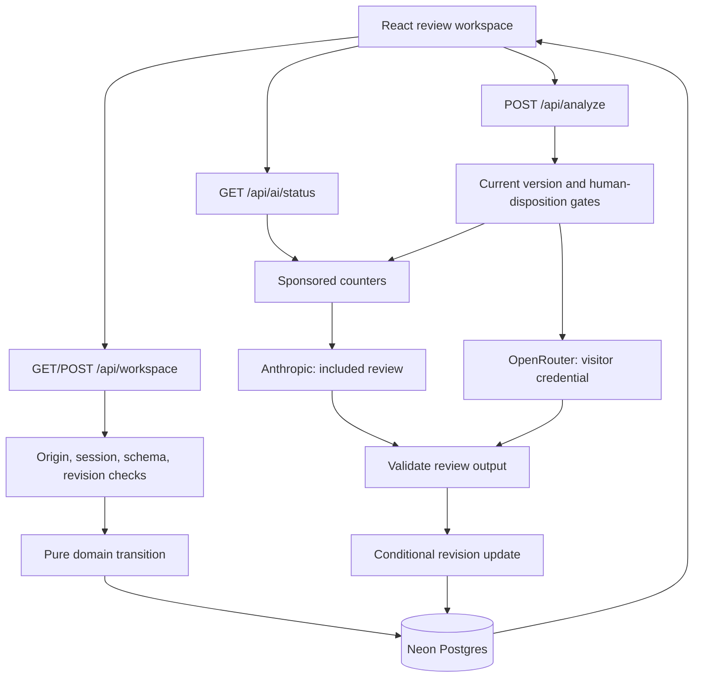

# Architecture and boundaries

## Request flow

Standard Next.js App Router runs on Vercel. Neon is accessed through its HTTP
Postgres driver with parameterized queries. React renders model and campaign
text as text, not injected HTML. Domain rules are independent of UI and storage.

## Records

| Table/object | Purpose |
| --- | --- |
| workspaces | Workspace JSON, revision counter and update timestamp |
| campaign → versions → analysis/decision | Exact creative, findings, proposed copy, model/usage, human decision |
| workspace events | Actor, campaign/version, action, timestamp, explanation |
| oauth_attempts | Hashed state, browser workspace, verifier, origin, return path, expiry |
| ai_connections | Workspace-bound encrypted visitor key, management hash, expiry, review-rate claim |
| sponsored_budget | Global lifetime attempt counter for `demo-v1` |
| sponsored_sessions | Per-workspace attempt counter and last-start timestamp |

A JSON workspace is a deliberate prototype tradeoff. It is bounded to fifty
campaigns but does not have production-grade event/version retention or
normalization. The API preserves history; a database administrator or demo reset
can change it. It is not an independently immutable audit ledger.

## Session and write controls

A random UUID in an HTTP-only, SameSite=Lax cookie identifies one fictional
workspace; HTTPS cookies are Secure. It is a bearer capability, not a real user
identity or tenant membership. Role switching simulates colleagues.

Mutating requests require the app's origin, JSON content and bounded input. The
server streams at most 30,000 body bytes before parsing and rejects larger input.
Creative has a 6,000-character limit. Schema validation restricts actions, roles,
products, channels and AI provider/model identifiers.

A normal write loads revision N, applies a pure transition to a clone, and executes
an UPDATE whose WHERE clause requires the same workspace and revision N. It
increments the revision and returns the new record. Zero affected rows means 409.
AI performs the same final check after inference. A paid call may finish without
saving when another tab changed the workspace; its allowance is not refunded.

## Human decision rules

Approval requires every current finding to be dismissed or corrected through a
new version, plus an explicit human attestation. Dismissals require reasons.
Confirmed findings remain unresolved. A new version resets analysis/decision
and retains previous creative and decisions. The API rejects replacing a decision
on a decided version. AI cannot overwrite analysis after human dispositions.

## AI providers and output contract

Both providers use the same applicable-policy prompt and validation function.
Included AI calls Anthropic Messages with Claude Haiku 5.5; visitor-funded AI calls
OpenRouter Chat Completions with GPT-4.1 Mini. Endpoints/models are fixed, credentials
travel only in headers, redirects are rejected, and the timeout is 45 seconds.
No tools or automatic retries are enabled. Provider error bodies are not returned
to the browser or logged by application code.

The response contains summary, findings and optional proposed copy. Zod checks
shape, lengths and count. Quotations must match the submitted creative exactly;
policy IDs must apply to the product and channel. Human-only CP-06 is excluded
from model findings. Basic deterministic concerns remain when not already covered.
Drafts introducing unseen numerical values or unfinished placeholders are withheld.
This does not validate numerical relationships, infer missing offer facts, prove
legal correctness, or make the system immune to prompt injection.

## Sponsored admission

When explicitly enabled and a server key exists, each workspace can start two
included attempts, at most one per minute. The global `demo-v1` row admits twenty
attempts over its lifetime. A single SQL statement claims the session and global
counters atomically, so concurrent function instances cannot exceed the caps.
Each attempt reserves $0.05 conservatively, giving a $1 application admission
allowance. Attempts, including provider failures, consume quota. Demo reset and
routine schema migrations cannot replenish it. This is separate from provider
account billing or usage of the same key by other applications.

## Visitor OAuth

A same-origin start request creates ten-minute PKCE S256/state credentials bound
to the browser cookie and current origin. The callback consumes matching state
atomically before exchange or cancellation; consumed state cannot be replayed.
Authorization codes are exchanged only server-side at OpenRouter's fixed HTTPS
endpoint. The resulting key is encrypted with AES-GCM under AI_CONNECTION_SECRET,
using the workspace ID as authenticated associated data. Access expires after
24 hours. Only connection metadata is exposed. Disconnect deletes the stored
credential and pending attempts; provider key revocation is a separate user action.
Expired rows may remain until replacement or disconnect.

## Production boundary

Real identity/memberships, per-campaign authorization and locking, normalized
storage, retention, independent audit controls, broader abuse prevention,
redacted observability and maintained policy governance are future work. Text
review cannot verify final placement, linked documents, real offers or audience.
The product demonstrates a workflow and a bounded AI copilot; it does not certify
financial marketing or prove an improvement in reviewer throughput.
