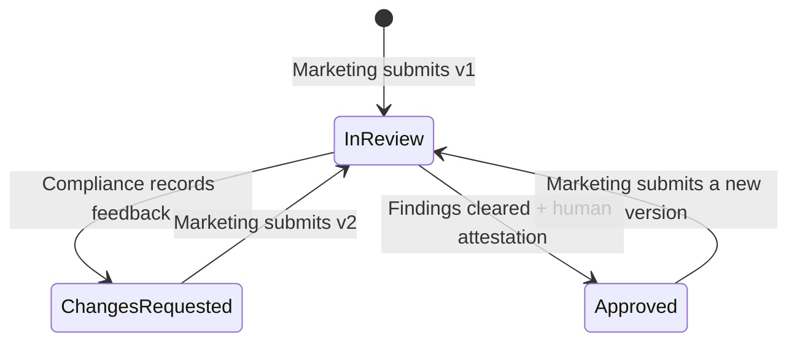
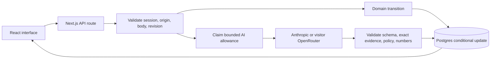

# ClearPath: the mental model

## The sentence to remember

**A campaign moves through a versioned review desk: AI proposes, Marketing revises, Compliance decides.**

The product is built around the decision, not around a chat conversation. A useful
review needs the exact ad, its product and placement context, the concerns, the
correction, and the person who accepted the final version.

## The five objects

| Object | What it means | Example |
| --- | --- | --- |
| Workspace | One browser's isolated fictional desk | Your demo differs from the visitor's |
| Campaign | The ongoing marketing submission | BrightMoney's personal-loan ad |
| Version | An exact snapshot of creative | v1 promises approval; v2 changes that claim |
| Finding | Evidence plus a policy concern and human disposition | Quote → CP-01 → suggested correction |
| Decision/event | The person, version, action, time, and explanation | Alex requested changes on v1 |

A campaign has many versions. Each version owns its own analysis and decision.
Events connect actions to their version. The latest version determines the
campaign's current status.

## The workflow

The arrow from Approved starts a **new version**. It does not edit or erase the
old approval. Confirming an issue means it needs correction. Dismissing an issue
requires a reason. Neither AI nor an empty findings list records an approval.

## What happens after a click

1. The browser sends an action and the revision number it last loaded.
2. The server checks the cookie, same origin, input limits, and business rules.
3. A normal action passes through a pure domain function. AI requests first claim
   their allowance and then ask the fixed provider for a structured review.
4. The server saves only if the database revision still matches. A conflicting
   tab receives 409 and refreshes; a delayed AI response cannot erase newer work.
5. The browser renders the saved response. Reloading fetches the server record.

The UI makes the workflow convenient; the server enforces it. Disabling a button
is not the approval control. The domain function and conditional database write
are the controls.

## Where the AI begins and ends

A fixed system prompt contains the applicable illustrative checklist. Creative is
encoded as untrusted JSON data. The model returns a summary, findings, and an
optional proposed copy. It has no tools, database access, approval action, email
sender, or publishing permission.

The server checks structure, bounds, applicable policy IDs and exact quotations.
It withholds proposed copy containing numerical values absent from the original.
Basic deterministic checks remain alongside the model when not already covered.
These checks limit specific errors; they do not prove truth, legal completeness,
resistance to every prompt injection, or factual correctness of a rewrite.

CP-06 is a human checklist enforced by the approval attestation. It is not emitted
as a generic AI finding. Routine reminders belong in the summary, so clean copy
does not acquire fake problems merely because actual placement is unavailable.

## How an visitor can try real AI

Sponsored mode uses a server-only Anthropic credential and Claude Haiku 5.5.
No provider signup is needed for two included attempts per browser workspace,
subject to one attempt per minute and twenty attempts globally for this demo.
Every attempt reserves $0.05 conservatively against a $1 demo allowance; failures
consume allowance and there are no automatic retries. This is an application
admission limit, not a provider-account billing limit.

The optional OpenRouter OAuth path uses the visitor's account, encrypted
credentials, and GPT-4.1 Mini. That account funds its own inference. Its successful
real-user OAuth grant is a separate verification boundary from sponsored AI.

## Three distinctions that make the explanation honest

| Distinction | Say this |
| --- | --- |
| Sample vs live | Initial examples are curated. LIVE AI means a completed provider response passed validation and was saved. |
| Triage vs certification | These are potential concerns under an illustrative checklist; the human checks the complete context. |
| Prototype vs production | Demo roles are conveniences. Real identity, tenant membership, retention, policy governance, and stronger abuse controls are future work. |

## Your 60-second architecture explanation

“React handles the workspace. Next.js routes validate requests and call a pure
TypeScript domain layer. Postgres stores one JSON workspace with a revision
counter, which is simple for this prototype. Conditional writes prevent lost
updates. AI is a bounded service call that produces recommendations, followed by
server validation. The approval transition always remains human-controlled and
specific to one creative version. Vercel hosts the routes, and Neon hosts Postgres.”

## Your learning route

Read [DEMO.md](DEMO.md), then inspect `lib/domain.ts`, `app/api/workspace/route.ts`,
`app/api/analyze/route.ts`, and `lib/ai.ts`. Use [DESIGN_DECISIONS.md](DESIGN_DECISIONS.md) to
practice tradeoff questions and [VERIFICATION.md](VERIFICATION.md) for actual
results. You do not need to memorize every component to explain these boundaries.
